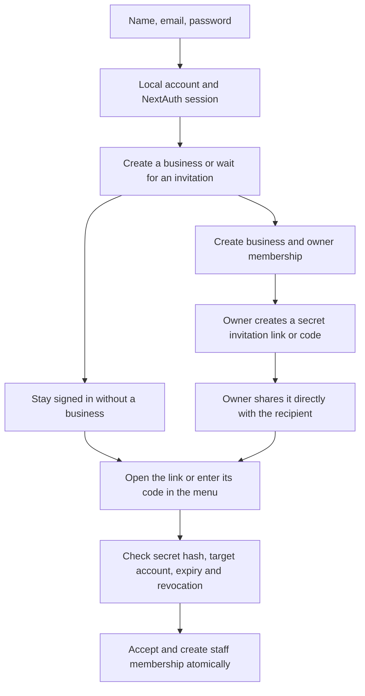

# NextAuth migration without signup emails

Date: 2026-11-07. Status: approved by Felix; implemented and validated.

Follow-up: Felix approved `INBOX_INVITATIONS_PRD.md` to replace secret codes
with automatic email-scoped inbox invitations. Code-related notes below describe
the earlier implementation; the inbox PRD and current README describe today's flow.

## 1. Problem

Hosted Supabase Auth currently sends signup confirmation emails. Its built-in
sender has a project-wide two-emails/hour cap. This prevents continued testing.
Felix requested NextAuth instead and selected email/password accounts with secret
invitation links/codes, rather than Google sign-in or custom SMTP.

NextAuth/Auth.js manages sessions and credential authorization, but its Credentials
provider does not create/persist user accounts or hash passwords automatically.
Those responsibilities need an application implementation.

## 2. Success criteria

- Register with name, email and password without sending an email, requiring
  email confirmation, or calling Supabase Auth. Signup never creates a business.
- Store application accounts and password hashes in PostgreSQL through Prisma.
  Login/logout and protected sessions use NextAuth/Auth.js Credentials and JWT
  sessions. Passwords and hashes never enter client responses or logs.
- Keep the existing account-only create-or-wait onboarding, business ownership,
  staff permissions, business switching, and tenant scoping.
- Owners create an invitation and receive its secret link/code to share manually.
  Store only its hash. The raw secret is shown only when issued, not in later
  invitation list reads. No application invitation email is sent.
- A signed-in recipient must present the secret and satisfy the invitation's
  target-account rules before acceptance. Matching a typed email alone cannot
  grant membership or reveal private business/invitation details.
- Pending invitation acceptance is atomic, single-use, expiry/revocation aware,
  and safe under repeated/concurrent requests. Keep accept/reject and owner
  revocation in the UI. A recipient reaches the invitation screen from the shared
  link or enters a code in the hamburger menu.
- Remove the hosted email-sending cap from this flow by removing email sending.
  Keep protection against repeated password guessing; this is separate from the
  provider's email quota.

## 3. Scope

### Confirmed flow

### Identity and persistence

- Add a local `User` model with UUID ID, normalized unique email, display name,
  password hash and timestamps. Store bounded failed-login state for basic
  password-guessing protection. No OAuth `Account`, database `Session`, or email
  `VerificationToken` table is needed for this Credentials/JWT-only flow.
- Hash passwords with Node's standard scrypt implementation, random per-password
  salts, deliberate work/memory parameters, and constant-time comparison. Put
  cryptographic mechanics behind a typed adapter port; do not invent an algorithm.
- Add the local-user relation to `BusinessMember.userId`; preserve the existing
  business/membership/invitation tables and their tenant relationships.
- Reuse `BusinessInvitation.tokenHash` for the actual single-use secret. Generate
  cryptographically random secrets, expose a raw secret only during issuance,
  and prevent it from entering logs, normal DTOs, or third-party resources.
- An unverified email is an account identifier, not proof of mailbox ownership.
  Notification queries must not reveal private invitation/business details based
  solely on that identifier. The menu provides code entry and validated invitation
  details; following a valid shared link can surface the pending invitation there.
- Link claims use a page/form and a Server Function. Opening or prefetching a
  link must not consume it. After validation, avoid leaving the secret in browser
  navigation/referrer paths longer than necessary.

### Feature and dependency boundaries

- Keep `auth/` for account identity and `business-management/` for business and
  invitation use cases. Preserve `ui/`, `types/`, `core/`, `repository/`, and
  `services/` in both features.
- Contracts/ports remain framework independent. Core handles pure policy.
  Services receive ports. Repositories own Prisma/crypto adapters. Delivery
  wires Auth.js, sessions, cookies, validation, redirects and cache invalidation.
- Keep the public trusted-identity/business-context entry points so receipt and
  business callers do not import private adapters or auth-library internals.
- Replace Supabase session refresh in `src/proxy.ts` with Auth.js session handling.
  Continue isolating caches and active-business selection across accounts.
- Preserve the UI's current component/style system. Remove email-confirmation
  language and replace email-proof-dependent invitations with the chosen secret
  flow. Explain that owners share the invitation themselves.

### Auth.js framework route exception

Auth.js's documented Next.js integration requires a framework Route Handler for
its auth protocol. Add only that handler, delegating to the feature's delivery
configuration. This is a proposed narrow exception to AGENTS.md's internal
Route Handler prohibition. It is not permission to add business REST endpoints.

Our UI will use Server Functions for signup/login/logout and server `auth()` for
session reads. Do not add client session HTTP polling or internal feature APIs.
Felix's approval of this PRD explicitly approves this Auth.js handler exception.

### Migration safety

A read-only check on 2026-11-07 found zero Supabase users, zero businesses, zero
memberships and zero invitations in the configured database. No data was changed.
Recheck before applying a migration. If records appear in the meantime, preserve
them and obtain an account-ID mapping plan instead of resetting or deleting them.

Create an additive migration and matching Mermaid diagram. Do not alter managed
Supabase authentication tables or existing migration history. Removing Supabase
Auth from application code does not delete the Supabase project or PostgreSQL
database, and does not delete credentials from the user's environment silently.

Out of scope: Google/social login, password-reset email, SMTP setup, business
ownership transfer, purchase persistence, deployment, and new branches.

## 4. Constraints

- Pin a compatible NextAuth release based on its current official guidance and
  peer dependencies; do not upgrade Next.js, React, or Prisma as a side effect.
- Use the existing Prisma/PostgreSQL setup. Auth.js Credentials requires custom
  account persistence; do not add adapter tables solely to populate a template.
- Require a strong `AUTH_SECRET`, kept in ignored environment configuration and
  generated without printing it. Preserve production secure-cookie behavior.
- No TypeScript `any`, unchecked type bypasses, raw password logging, or raw
  database/SDK objects in feature contracts.
- No business or membership creation during signup. No fake `emailVerified=true`
  flag to bypass the old invitation policy.
- Current branch is `main`. Do not create or switch branches without permission.
- Keep the existing code usable until its callers and tests migrate together.

## 5. Plan

1. Felix approves this PRD, including the narrow Auth.js framework-handler exception.
2. Pin NextAuth, add the local account model and additive migration, and update
   the Mermaid/schema documentation. Recheck existing-record counts before any
   migration application; never use a reset or force/data-loss command.
3. Implement local registration, password hashing/verification, bounded failed-login
   handling, and typed user lookup through auth ports/adapters/core/use cases.
4. Wire Auth.js Credentials/JWT, Server Function login/signup/logout, server
   identity reads, proxy/session handling, and environment/deployment settings.
5. Implement secret invitation issuance, manual sharing, code/link claim and
   single-use acceptance, updating menu notifications and authorization tests.
6. Remove Supabase Auth consumers and obsolete confirmation UI in a coherent
   change. Keep PostgreSQL/Prisma and all business permissions intact.
7. Test account validation, hash verification, safe login errors, sessions,
   account-only signup, invalid/reused/expired/revoked secrets, identity/tenant
   checks, races and rollback. Run Prisma generation/validation, auth/business/DB
   tests, TypeScript, lint and production build; inspect the rendered UI.
8. Exercise the complete local two-account signup/create/invite/accept flow when
   the database migration is applied, and commit the implementation checkpoint
   on the existing branch. Report any remaining environment/build limitation.

Rollback: revert application changes and return to the prior auth configuration.
Do not automatically drop local accounts or erase business records. Auth.js and
Supabase sessions are different, so users will need to sign in after the switch.

## 6. Open questions and recorded decisions

- **Confirmed by Felix:** use NextAuth, keep email/password signup, and replace
  email-only invitation acceptance with secret invitation links/codes. No SMTP.
- **Approved by Felix:** the Auth.js framework Route Handler is the narrow
  exception described above. Implementation approval: “okay do it”.
- **Approved defaults:** retain seven-day staff invitations; require the signed-in
  account's email to match the target as well as possession of the secret. Email
  ownership is not claimed to be verified. Password reset remains unimplemented.
- **Live migration:** database counts were zero at inspection, but the agent will
  recheck rather than assuming this remains true.

References: [Auth.js Credentials](https://authjs.dev/getting-started/authentication/credentials),
[Auth.js Next.js setup](https://authjs.dev/getting-started/installation), and
[Supabase email limits](https://supabase.com/docs/guides/auth/rate-limits).

## Implementation notes — 2026-11-07

- Pinned `next-auth@5.0.0-beta.32`, whose declared peers support the installed
  Next.js 16 and React 19. Removed Supabase Auth SDK consumers/dependencies;
  retained PostgreSQL and existing ignored provider credentials.
- Rechecked live counts: zero hosted auth users, businesses, memberships and
  invitations. Applied the additive `20261107120000_local_credentials` migration
  without resetting history or touching managed auth tables.
- Added local account persistence, salted scrypt, atomic failed-login updates,
  seven-day JWT sessions, and fresh account lookup for protected operations.
  Generated an ignored local `AUTH_SECRET` without printing it.
- Owners receive a random 256-bit invite code once; only SHA-256 persists.
  Links use fragments, cleared on load. The HTTP-only proof cookie and trusted
  account are rechecked on every preview/acceptance. Acceptance also binds the
  displayed invitation ID, protecting against a code changed in another tab.
- Existing onboarding, tenant scopes and owner/staff permissions are retained.
  Cleared cached auth form fields after success. Kept home panels stacked at
  tablet widths. Account-dependent home/settings routes deliberately opt out of
  instant-navigation validation because onboarding may replace their segment.
- Live localhost verification used two synthetic accounts: signup without mail,
  account-only onboarding, optional business creation, invitation issuance/link,
  fragment clearing, hamburger notification, staff acceptance, staff restrictions,
  failed-password feedback, successful login, consumed-link rejection and logout.
  Inspected 390/768/1440px layouts. Removed only these synthetic database records
  in a guarded transaction afterward; the browser is signed out.
- Automated checks cover account/hash/lockout/session boundaries, secret lookup,
  identity and tenant authorization, expiry/revocation/replay, acceptance races,
  rollback and stale invitation forms. Purchasing/OCR and password recovery remain
  outside this change.
- The default Turbopack production build still reproduces the existing Windows
  CSS-worker startup failure. The supported `next build --webpack` path passes
  compilation, TypeScript, prerendering and standalone trace generation.
- Final checks: `pnpm test:auth` (15), `pnpm test:business` (29), `pnpm test:db`
  (2), `pnpm lint`, `pnpm exec tsc --noEmit`, Prisma generation/format/validation,
  and diff whitespace checks passed. Live `prisma migrate diff` reported no
  difference between the database and `schema.prisma`. UI source style lint
  reported zero failures/warnings. No deployment or new branch was created.
