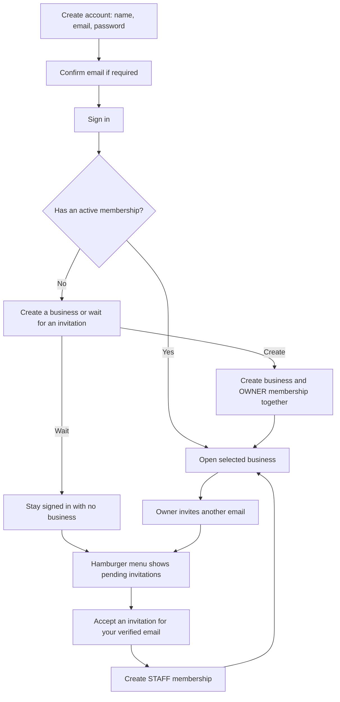

# Account signup, business creation, and invitations

Date: 2026-11-07. Status: implemented; automated and visual verification complete,
with real two-account acceptance testing pending a valid test account.

## 1. Problem

Account registration currently requires a business name, although someone may
register only to join another person's business. Business profile, team, and
invitation settings are mocked. There is no business-free account experience,
real invitation inbox, or hamburger menu. Existing auth implementation also
mixes delivery/provider responsibilities into `services/`.

Login currently reports some provider failures as a generic authentication error.
The local Supabase URL/key were accepted by a read-only Auth settings request;
email authentication and signup are enabled, and email confirmation is required.
The exact reported login failure has not been reproduced with a real account.

## 2. Success criteria

- Signup asks for name, email, and password only. It creates a Supabase account
  without creating a `Business` or `BusinessMember` and without requiring
  business metadata. Existing accounts continue to work.
- Email confirmation, login, sessions, and logout use Supabase. Expected errors
  are understandable; unexpected errors have safe server diagnostics without
  logging passwords, keys, cookies, or tokens.
- A signed-in account with zero memberships sees two choices: create a business
  or wait for an invitation. Waiting does not force business creation or logout.
  It does not display another business's mocked profile/team as the user's data.
- Creating a business persists its profile and the creator's `OWNER` membership
  atomically, then selects that business. Registration itself never creates it.
- An active owner can invite an email address as `STAFF`, including before that
  recipient registers. Creating an invitation does not create a membership.
- Pending invitations matching the authenticated user's verified email appear
  in the hamburger menu with a count, business name, and accept/dismiss actions.
  Expired, revoked, and accepted invitations are excluded from the pending count.
- Acceptance atomically consumes the valid invitation and creates/reactivates
  the recipient's membership. Repeated/concurrent acceptance cannot create
  duplicate memberships. Other users cannot inspect or accept that invitation.
- Owners can see real members and pending invitations and revoke an outstanding
  invitation. Staff cannot invite members, change ownership, or perform owner-only
  business updates. Dismissing an invitation grants no access.
- Active business selection is checked against current membership on every
  protected operation. A browser-supplied business ID or stale cookie never
  grants access. Users with multiple memberships can switch from the menu.
- No-business users retain account/menu/invitation access, while business-only
  screens and protected business actions require an active membership.

## 3. Scope

### User flow

### Feature ownership

Retain `src/features/auth/` for identity and add one business capability package,
`src/features/business-management/`, for business profiles, memberships, active
business selection, and in-app invitations. Membership and invitation tables do
not need separate feature packages. Both features use the existing five folders:

| Folder | Auth responsibility | Business-management responsibility |
| --- | --- | --- |
| `ui/` | Forms, session delivery, Server Functions, redirects/cookies | Onboarding, create-business form, invitation inbox/menu, team/profile settings, Server Functions and server queries |
| `types/` | Safe identity, inputs, results, auth provider port | Business/member/invitation DTOs, validated inputs, repository and transaction ports |
| `core/` | Pure auth outcome/error policies | Pure membership permissions, invitation eligibility/expiry, normalization rules |
| `repository/` | Supabase SDK calls and result mapping | Scoped Prisma queries, persistence mapping, atomic operations implementing ports |
| `services/` | Coordinate auth through provider ports and core | Coordinate business creation, invitations, acceptance, membership and settings use cases |

Add and read a `README.md` in each new layer before adding implementation there.
Move the touched legacy auth actions/session wiring to delivery, provider calls
to repository, and pure rules to core. Update callers and tests coherently;
do not refactor unrelated receipt processing.

Services receive repository/provider ports from `types/`; they do not import
concrete adapters. Core never calls repositories. Server-only delivery wires
dependencies. Cross-feature access uses explicit public contracts/service entry
points, with no cyclic dependency between auth and business management.

`src/app/` stays routing/composition only. Shared navigation accepts presentation
data or a component slot from route composition; shared components do not import
private business feature modules. Add a hamburger menu while preserving usable
desktop/mobile navigation and the existing visual style.

### Persistence and security

Reuse `Business`, `BusinessMember`, and `BusinessInvitation` plus their existing
indexes/relations. No local user/password table or notification table is needed:
pending invitation rows are the notification source. Existing signup business
metadata is not an authorization source or an automatically provisioned business.

Invitations are addressed by normalized email. Inbox queries use the trusted,
verified session email; owner management queries use the actor's authorized
business. All mutations recheck permissions, expiry, revocation, and membership.
Pass the current time into core rules. Proposed invitation lifetime: seven days.
Dismissal uses the existing revocation timestamp; no new status column is needed.

The current invitation schema requires `tokenHash`. Preserve compatibility by
generating an internal random hash on creation; do not expose a token or treat
it as the user's acceptance authority. Acceptance is an authenticated Server
Function governed by verified email ownership. No invitation email is sent.

Select the active business through an HTTP-only server cookie, validated against
active memberships on reads and mutations. Clear/re-evaluate it at logout/login
and when membership changes. Clear or scope existing client caches on account
or business changes to prevent stale cross-account/business displays.

Replace the mocked business/profile/team/invite behavior reached by this flow.
Keep unrelated invoice, procurement, inventory, supplier, and insight backend
implementation outside this task. Their placeholder data must not masquerade
as persisted data belonging to a newly created business. Use honest empty/demo
presentation where necessary and guard their reachable protected actions.

### Explicit exclusions

- Invitation emails, email delivery providers, or public invitation links.
- Password reset, social login, custom password storage, and custom auth tables.
- Inventory/procurement/receipt persistence, OCR integration, or a general
  notification service.
- Business deletion, ownership transfer, subscriptions, and extra role systems.
- Production deployment, database resets, or modifying existing migration history.
- New branches or branch switching without Felix's instruction.

## 4. Constraints

- Use the existing package-by-feature and hexagonal architecture, `core/`, strict
  TypeScript without `any`, pnpm, Supabase publishable-key auth, and Prisma 7.
- Use Server Components/server queries for reads and thin authenticated Next.js
  Server Functions for mutations. Do not introduce internal API endpoints.
- Read installed Next.js documentation before implementation. Read the relevant
  Prisma client/CLI skills before adding queries or migration work.
- Preserve Indonesian UI copy and accessible keyboard/focus/pending/error states.
  Match existing components and styles; visually verify the new menu/forms.
- Current checkout is `main` with a clean working tree before this PRD. Do not
  assume the earlier `change-schema` branch is still checked out or switch it.
- Do not print secrets or log real authentication credentials. Do not create test
  accounts, send confirmation emails, or change live merchant data silently.
- Reuse the schema if possible. Any necessary additive migration must be concrete
  and reviewed before application; never reset or edit the initial migration.

## 5. Plan

1. Felix approves this PRD. Invitation delivery is already confirmed as in-app only.
2. Update auth contracts/form/signup metadata and migrate touched auth code into
   its documented layers. Preserve direct-call authentication, session refresh,
   confirmation, and logout; improve safe error diagnosis.
3. Add the business-management feature with its five documented layers. Implement
   scoped persistence ports, pure rules, and business/membership/invitation use
   cases, including atomic creation and acceptance.
4. Wire business-free onboarding, creation, real team/profile controls, invitation
   inbox, hamburger badge, and active-business selection through server delivery.
   Replace the relevant mock settings behavior and update route composition.
5. Enforce business access at delivery/use-case entry points, including direct
   protected mutations. Verify no-business and removed-membership behavior.
6. Add meaningful fake-port tests for permissions, invitation ownership/expiry,
   duplicate requests and atomic outcomes. Add adapter/action validation coverage
   where needed. Update the package's test scripts for moved and new tests.
7. Run auth/business/database-helper tests, Prisma validation/generation,
   TypeScript, lint, and production build. Inspect the rendered signup,
   no-business state, menu/invitations, creation, and team controls on desktop
   and mobile. A real two-account exercise confirms create/invite/accept/login
   behavior once Felix provides or operates suitable test accounts.
8. Commit completed implementation checkpoints on the branch Felix has chosen
   and report any remaining external setup or live-verification limits.

Risks: accepting an invitation for the wrong identity, partial business/member
creation, concurrent invitation acceptance, stale business selection, and cached
data from another account. Address these in core/use-case tests, transactional
repository operations, per-operation checks, and cache scoping.

Rollback: revert this feature's code commits. Existing accounts and business
records remain intact. No database reset or automatic deletion is part of rollback.

## 6. Open questions and recorded decisions

- **Confirmed by Felix:** accounts start without a business; creation happens
  after signup. Invitations appear in the hamburger UI and are in-app only.
- **Proposed defaults:** invitees join as staff; only owners invite; invitations
  expire after seven days; verified email is required to accept; existing multiple
  memberships can be switched from the menu.
- **Live verification:** the existing generic login failure needs a real account
  reproduction/provider error code. Tests do not prove that a particular user's
  password, email confirmation, or dashboard configuration is correct.
- **Branch:** currently on `main`. No branch creation or switching is included.

Approval authorizes the application changes described above, including the
necessary new feature and touched auth refactor. It does not authorize sending
invitation emails, applying destructive migrations, or creating a branch.

## Implementation notes

- Signup is account-only; business-management now owns creation, membership,
  profile/preferences, and in-app invitations. The original schema is reused.
- Touched auth delivery and provider code has moved into its documented layers.
  Services receive ports, and pure outcome policies live in core.
- The existing mock purchasing behavior remains under `invoice-processing/services`
  and `src/lib/api`. It is gated by membership and labeled as demo data. Migrating
  its persistence/legacy delivery code remains a separate task.
- Invitation notifications refresh on navigation, menu opening, window focus,
  and explicit refresh. No realtime subscription, email provider, or notification
  table was added.
- Visual direction: accent-ladder, seed 1999176778, preserving Onyxa's emerald
  accent and existing typography. No redraw. Screen questions: create or join a
  business; which invitation needs a response; who has access to the business.
  Local-only fixtures use `contoh.invalid` addresses and never reach Supabase.
- During live signup troubleshooting, Felix reported `email_address_invalid`.
  The UI now exposes allowlisted support codes and explains the provider's
  example/test-address rejection. Unknown provider details remain server-side.
- No branch was created or switched. No accounts, businesses, invitations,
  memberships, or migration changes were written to the live database by the agent.

### Verification

- `pnpm test:auth`: 28 passing tests.
- `pnpm test:business`: 25 passing tests across core, services, adapters and delivery.
- `pnpm test:db`: two passing tests; Prisma client generation passed.
- `pnpm db:validate`, `pnpm exec tsc --noEmit`, `pnpm lint`, and
  `git diff --check` passed.
- `pnpm exec next build --webpack`: production compilation, TypeScript,
  prerendering, and build traces passed. The normal Turbopack build fails on this
  Windows runner because its CSS worker exits before connecting. It failed both
  inside and outside the sandbox. The existing CSS/configuration was not changed
  to work around it; the default build limitation remains explicit.
- Read-only live Prisma checks reached all three business tables. Read-only
  Auth settings accepted the configured URL/key. No custom `auth.users` triggers
  were found. These checks changed no records.
- An isolated browser login with a deliberately nonexistent address displayed
  the expected invalid-credentials error and its safe support code. No signup
  emails were sent by the agent.
- Actual onboarding/settings components were visually checked using local-only
  fixtures at desktop and mobile widths. Invitations were moved before creation
  when pending, with matching visual and keyboard order. Product-only design
  lint passed; reserved test email addresses are confined to tests/fixtures.
- Felix's signup error was narrowed to the public `email_address_invalid` code.
  The entered Gmail username had four characters; Supabase's validator rejects
  Gmail local parts shorter than six. Use an actual accepted inbox for the final
  real-account signup/confirmation/create/invite/accept exercise.

Remaining validation: the authenticated hamburger's interactions and the full
two-account live business workflow have not been exercised with real sessions.
They are covered by unit/adapter/action tests, but those are not a substitute
for the final live exercise. No database migration is required for this feature.
