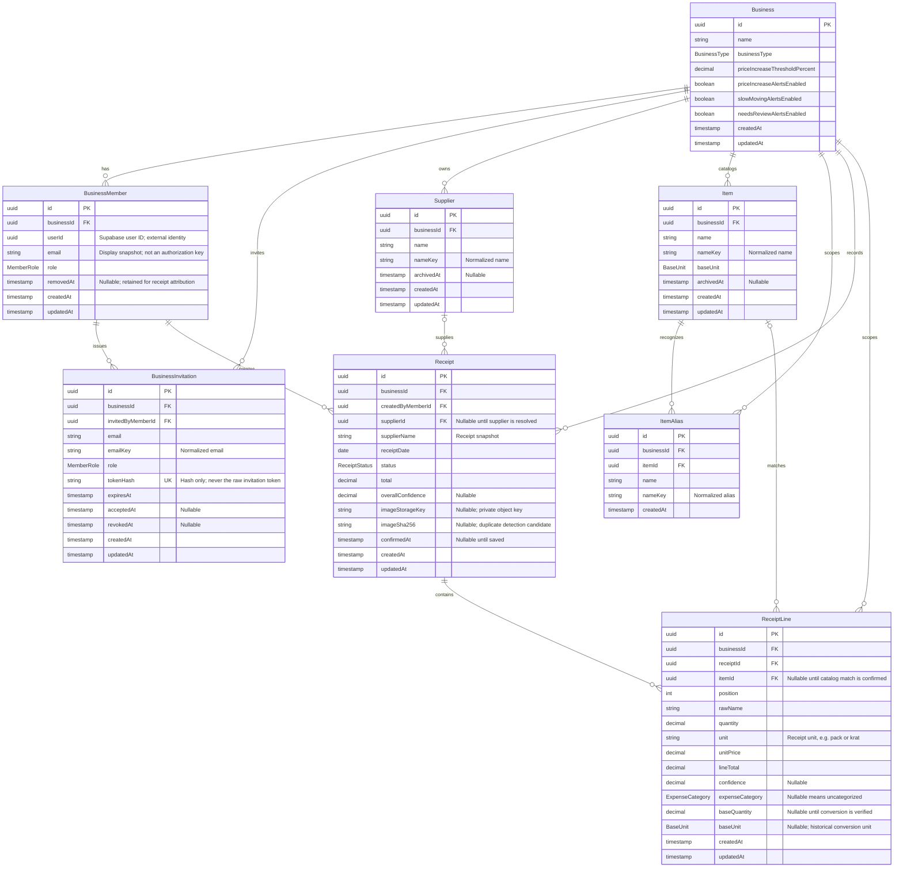

# Database schema proposal

Date: 2026-11-07. Status: proposed; awaiting Felix's PRD sign-off before Prisma implementation.

## 1. Problem

Onyxa has Supabase authentication, a receipt review flow, and mock transaction,
item, supplier, insight, and business-settings data. Its Prisma schema has no
application models. The project needs an agreed data model before backend work
can replace the mocks.

This proposal follows the existing README, scan contracts, and screens. It does
not change the feature architecture.

## 2. Success criteria

- A Mermaid entity relationship diagram describes the proposed application tables.
- After PRD approval, `prisma/schema.prisma` matches the diagram, including
  relationships, enums, nullability, uniqueness, indexes, and deletion behavior.
- Businesses isolate their data, while owners and staff can share one business.
- Receipt lines retain the names, units, quantities, prices, and confidence from
  review, independently of later catalog edits.
- Confirmed purchases supply item price history, supplier comparisons, and
  repurchase analysis without duplicate price-history or insight tables.
- Prisma formatting, validation, and generation pass without applying changes
  to a database. Existing database-helper tests and TypeScript checking pass.

## 3. Scope

### Proposed Mermaid ER diagram

The names below are the proposed Prisma model and field names. `?` in comments
means nullable. UUID identifiers are strings in Prisma. Timestamps use
PostgreSQL `timestamptz`; `receiptDate` uses `date`.

### Model decisions

| Decision | Proposed behavior |
| --- | --- |
| Tenant | A business owns its suppliers, catalog, receipts, and settings. Membership grants owner/staff access; data does not belong only to the uploading user. |
| Authentication | Supabase remains the identity provider. `BusinessMember.userId` stores its UUID, without modeling or migrating `auth.users`. There is no local password/session table or database FK into managed authentication tables. |
| Team invitations | Pending invitations are separate from active membership. Store only a token hash. Invitation acceptance and sending email remain later backend work. |
| Alert preferences | Store the existing four settings directly on `Business`; a separate one-to-one settings table is unnecessary. |
| Receipt status | `NEEDS_REVIEW` and `SAVED` map to the current `needs-check` and `saved` UI values. Only `SAVED` receipts participate in spending and purchase insights. |
| Drafts | Persist structurally valid extracted receipts needing review. Incomplete/failed OCR jobs and processing queues are outside this version. |
| Receipt amounts | Preserve receipt total, line total, and unit price separately. A mismatch is review data; do not silently overwrite it or enforce equality before reconciliation rules are agreed. |
| Currency | This version assumes IDR throughout, matching the existing UI. Multi-currency accounting is outside scope. |
| Catalog matching | Preserve the receipt's raw item name and store an optional catalog item ID. Display text is not a foreign key. |
| Aliases | Alias names are normalized and unique per business so automatic matching has one target. Pack-size conversion is not inferred from alias text. |
| Unit conversion | Preserve receipt units. Store verified `baseQuantity` and a `baseUnit` snapshot together. For example, 2 packs of 500 g can become 1 kg only after the conversion is known. |
| Comparable prices | Derive price per base unit as `lineTotal / baseQuantity` from saved, matched, converted lines. Compare like units and the same supplier for supplier price alerts. Unconverted lines remain visible but do not drive normalized comparisons. |
| Historical data | Archive suppliers/items and retain removed members. Restrict deleting referenced records. Receipt names and conversion units remain snapshots. |
| Insights | Calculate price changes, latest prices, last purchase dates, and slow-moving indicators from saved receipts. No stored insight text, stock balance, sales, or stock-movement tables. |
| Duplicate receipts | Index business/date/supplier/total and business/image hash for candidate searches. Do not make these combinations unique: legitimate receipts can share them. |
| Image storage | Store a private storage object key, not image bytes, temporary blob URLs, or expiring signed URLs. Upload implementation is deferred. |

### Proposed Prisma types and constraints

| Kind | Proposed definition |
| --- | --- |
| IDs | `String` with `@db.Uuid`; application model IDs use UUID defaults. |
| Money | `Decimal @db.Decimal(18, 2)` for total, unit price, and line total. Never floating point. |
| Quantities | `Decimal @db.Decimal(18, 6)` for receipt and base quantities. |
| Confidence | Nullable `Decimal @db.Decimal(4, 3)`; valid range 0 through 1. |
| Price alert threshold | `Decimal @db.Decimal(5, 2)`, default 5; current settings UI permits 1 through 100. |
| BusinessType | `CAFE_RESTAURANT`, `STORE`, `OTHER`; default `OTHER`. |
| MemberRole | `OWNER`, `STAFF`. The backend must preserve at least one active owner. |
| BaseUnit | `KG`, `LITER`, `PCS`, matching current catalog contracts. |
| ReceiptStatus | `NEEDS_REVIEW`, `SAVED`; default `NEEDS_REVIEW`. |
| ExpenseCategory | `COGS`, `OPEX`, `CAPEX`; nullable on each receipt line. |
| BusinessMember | Unique `(businessId, userId)`; index `userId` for finding the authenticated user's businesses. |
| BusinessInvitation | Unique `tokenHash`; indexes `(businessId, emailKey)` and `expiresAt`. Invitation history is retained; active duplicate invitations are prevented in the use case. |
| Supplier / Item | Unique `(businessId, nameKey)`; archiving preserves this identity so later purchases can reuse/reactivate it. |
| ItemAlias | Unique `(businessId, nameKey)` and index `(businessId, itemId)`. |
| ReceiptLine ordering | Unique `(businessId, receiptId, position)`. |
| Tenant consistency | Tenant-owned parent models expose unique `(businessId, id)` pairs. Child references use composite foreign keys including `businessId` to reject cross-business links. |
| Receipt indexes | `(businessId, receiptDate)`, `(businessId, status, receiptDate)`, `(businessId, supplierId, receiptDate)`, `(businessId, imageSha256)`. |
| ReceiptLine indexes | `(businessId, itemId, receiptId)` plus the receipt/position unique key. |
| Referential actions | Restrict deleting businesses and referenced suppliers/items/members. Receipt-to-lines and item-to-aliases may cascade when those parents are deliberately deleted. No automatic deletion of purchase history when a team member leaves. |

The future delivery boundary validates untrusted inputs. Core/use cases enforce
positive quantities, nonnegative amounts, confidence ranges, nonempty saved
receipts, valid status/confirmation transitions, and paired conversion fields.
Prisma does not express PostgreSQL CHECK constraints for these rules; a later
migration may add database checks alongside application validation. Schema
validation alone does not prove authorization or these business invariants.

### Explicitly outside this change

- Backend services, repository adapters, Server Functions, UI rewiring, or mock removal.
- OCR/Gemini integration, uploads, invitation delivery, or membership provisioning.
- Database connections, migration application, seed data, or production changes.
- Supabase-managed schema changes or new authentication providers.
- Sales, on-hand stock, accounting ledgers, tax/discount allocation, and arbitrary unit conversion.
- New feature folders or changes to architectural responsibilities.

## 4. Constraints

- PostgreSQL, installed Prisma 7.10.1, existing generator/output, existing lazy
  Prisma helper, and pnpm scripts remain in use. No new dependency is needed.
- Application data models live in `prisma/schema.prisma`; this design remains
  documentation until approved. Feature contracts remain independent of Prisma.
- Future feature repositories own data access, services receive repository ports,
  and server-only delivery code wires adapters. No internal HTTP API is introduced.
- Existing unrelated working-tree changes, including feature scaffolding and
  `AGENTS.md`, must be preserved.

## 5. Plan

1. Felix reviews this PRD, especially the assumptions below, and authorizes Prisma implementation.
2. Add the eight proposed models and enums to `prisma/schema.prisma`, preserving
   the generator and datasource configuration. Update this document if the
   implemented design differs.
3. Run `pnpm db:format`, `pnpm db:validate`, `pnpm db:generate`, `pnpm test:db`,
   and `pnpm exec tsc --noEmit`. Review the diff and diagram against the schema.
4. Present the matching Mermaid and Prisma artifacts for Felix's schema review.
   Backend work and database application wait for his next instruction.

Risk: uncertain unit conversions can produce incorrect price comparisons; only
verified, comparable quantities may participate. Risk: Prisma models do not
enforce permission policies; later use cases and repository queries must resolve
active membership from the trusted session and scope every operation.

Rollback: revert only this task's documentation and Prisma changes. No database
rollback is needed because this phase applies no migrations.

## 6. Open questions / assumptions for review

1. **Shared business:** assume owners and staff share one business catalog and
   receipt history, as implied by the existing team settings. The membership
   relation can support multiple businesses without adding business-switching UI.
2. **Expense categories:** propose categorization per receipt line so a mixed
   receipt can contain COGS, OPEX, and CapEx. Categories are currently described
   in the README but are absent from the editable scan contract.
3. **Units:** keep the current catalog's kg/liter/pcs base units. Pack and krat
   remain receipt units requiring verified conversion before price comparison.
4. **Slow-moving policy:** the README describes unusually long repurchase gaps;
   no threshold algorithm is implemented. Keep the policy out of the schema
   until the backend feature defines it.

These assumptions can be revised during review. Approval of this PRD authorizes
only creating and validating the schema artifacts, not implementing the backend.
