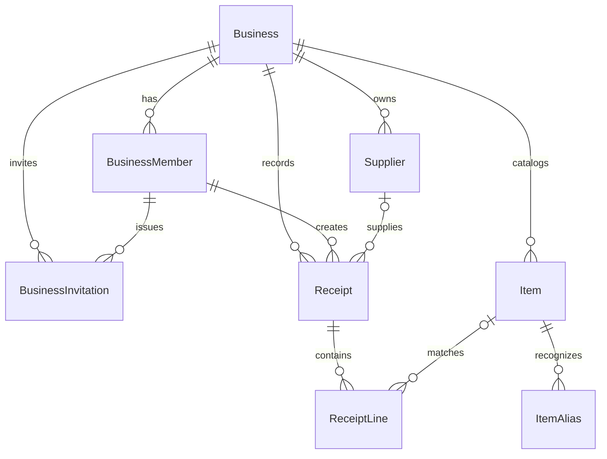

# Database schema for review

Recreated on 2026-11-07 from the earlier schema proposal. Schema files only;
backend implementation and database application await Felix's review.

## 1. Problem

The previous schema proposal is missing. Prisma still has no application models,
while the receipt, catalog, supplier, business, and team screens use mock data.
Restore the design and provide a matching Prisma schema before backend work.

## 2. Success criteria

- Eight application models match the detailed [Mermaid ER diagram](database-schema.mmd).
- The schema supports shared businesses, receipt review, catalog matching,
  expense categorization, and the existing settings.
- Relationships reject links between different businesses.
- Prisma formatting, validation, generation, database-helper tests, and
  TypeScript checking pass without connecting to a database.

## 3. Scope

Read `||--o{` as “one parent can have many children.” Read `|o--o{` as
“a child can optionally reference one parent.” A review receipt can temporarily
have no lines; saving it must require at least one valid line.

| Table | What it stores |
| --- | --- |
| Business | Business profile and price/review/slow-moving alert preferences. |
| BusinessMember | A Supabase user’s owner/staff membership in a business. |
| BusinessInvitation | Pending team access, with a hashed token and expiry. |
| Supplier | The business’s supplier list. |
| Item | The business’s master catalog and base units. |
| ItemAlias | Alternate receipt names that identify a catalog item. |
| Receipt | Supplier/date/total/image and review or saved status. |
| ReceiptLine | Individual purchases, optional catalog matches and categories. |

The detailed Mermaid file contains every persisted field. Relation properties
and indexes are defined in [schema.prisma](schema.prisma). A `?` in a diagram
field comment means nullable. The diagram uses `uuid`, `date`, `timestamp`, and
`decimal` for the corresponding PostgreSQL types.

### Design decisions

- **Business ownership:** data belongs to a business, allowing staff and owners
  to share it. Every child includes `businessId`. Composite foreign keys include
  that ID so a receipt cannot reference another business’s supplier or member,
  and a line cannot reference another business’s receipt or item.
- **Identity:** Supabase owns users, passwords, and sessions. `userId` stores the
  external UUID; Prisma does not manage `auth.users` or reference it with a
  database foreign key. Member email is a display snapshot, never authorization.
- **Membership:** `(businessId, userId)` is unique. Removed memberships are
  retained with `removedAt` for historical attribution. Invitations do not grant
  membership until accepted. Only token hashes are stored.
- **Names:** supplier/item/alias keys are normalized in application code and
  unique per business within their respective tables. An alias has one catalog
  target. Archived supplier/item names retain their identity for reuse.
- **Money:** amounts use `Decimal(18,2)` in IDR. Quantities use
  `Decimal(18,6)`; confidence uses nullable `Decimal(4,3)`. Alert percentage uses
  `Decimal(5,2)`, default 5. Do not use floating point for persisted money.
- **Status:** `NEEDS_REVIEW` maps to `needs-check`; `SAVED` maps to `saved`.
  Only saved receipts contribute to spending and purchase insights.
- **Receipt snapshots:** supplier name, raw item name, receipt unit, quantity,
  unit price, and line total remain available after catalog/supplier edits.
  The receipt total is stored separately so mismatches remain reviewable.
- **Images:** nullable `imageUrl` matches the existing Cloudinary upload result.
  It must come from a trusted upload result; URL shape alone does not establish
  ownership. No image bytes or temporary browser blob URLs are stored.
- **Comparable units:** preserve original units such as pack/krat. Set
  `baseQuantity` and a `baseUnit` snapshot together only after conversion is
  verified. Derive price per base unit as `lineTotal / baseQuantity`. Do not
  infer conversions from aliases or compare unconverted prices.
- **Derived insights:** price history, latest supplier prices, last purchase
  dates, price alerts, and repurchase gaps come from saved receipt lines.
  Separate price-history, insight, and stock-balance tables are unnecessary.
- **Categories:** nullable per-line `COGS`, `OPEX`, or `CAPEX` supports mixed
  receipts. Null means uncategorized.
- **Deletion:** referenced businesses, members, items, and suppliers are
  restricted from deletion. Items/suppliers can be archived. Deleting a receipt
  explicitly deletes its lines; deleting an unreferenced item deletes aliases.
  Removing a member never automatically deletes receipts.
- **Duplicates:** image hashes and supplier/date/total searches identify review
  candidates. They are not unique constraints because legitimate receipts can
  share those values. Hash calculation is deferred to backend work.

### Rules for later backend work

Prisma validates types and relationships, not the complete business workflow.
Use trusted sessions and active memberships for authorization. Enforce owner
permissions and preserve at least one active owner. Validate positive quantities,
nonnegative amounts, confidence from 0 to 1, threshold from 1 to 100, normalized
names, invitation expiry/revocation, and paired conversion fields. A saved receipt
requires valid lines and `confirmedAt`; catalog conversion units must match the
item’s base unit. Unmatched/unconverted lines do not drive price comparisons.

Prisma cannot declare PostgreSQL CHECK constraints in this schema. Add appropriate
checks when writing the reviewed migration. No row-level security policies or
application authorization are implemented by these files.

Out of scope: migrations, seed data, database writes, backend services/adapters,
UI rewiring, invitation emails, OCR integration, sales/stock ledgers, multi-currency
accounting, tax/discount allocation, and arbitrary unit-conversion rules.

## 4. Constraints

Keep PostgreSQL and installed Prisma 7.10.1, the existing generator and lazy
client, Supabase authentication, pnpm scripts, and feature architecture. Do not
introduce internal APIs, change managed auth tables, or reorganize features.
The schema documents proposed persistence; existing mocks continue running.

Keep these artifacts under `prisma/`, because `/docs` is intentionally ignored
by the current repository configuration.

## 5. Plan

1. Recreate this PRD and the earlier eight-model design under `prisma/`.
2. Create the matching Prisma models, enums, indexes, and tenant-scoped relations.
3. Format, validate, regenerate the client, and run database-helper and TypeScript checks.
4. Present both representations for Felix’s review before any backend/database work.

The user’s request to recreate the schema authorizes this restoration after the
earlier PRD. It does not authorize applying the schema to a database.

Rollback requires reverting only these schema/review files; no database state
is changed. The main risks are incorrect unit conversion and incomplete future
authorization, which need explicit handling when implementing the backend.

Validation on 2026-11-07: `pnpm db:format`, `pnpm db:validate`, `pnpm test:db`
(including client generation; two tests), `pnpm exec tsc --noEmit`, and
`git diff --check` passed. A structural comparison also verified all eight
models' persisted fields and nullability against the detailed Mermaid file.
No live database or diagram renderer was used.

## 6. Open questions for schema review

- Confirm shared business data with owner/staff memberships.
- Confirm per-line expense categories and kg/liter/pcs catalog base units.
- Define the slow-moving algorithm during backend work; do not encode an
  invented threshold in this schema.
- Review the existing Cloudinary access model before persisting real merchant
  images. This restoration does not change uploads or access controls.
